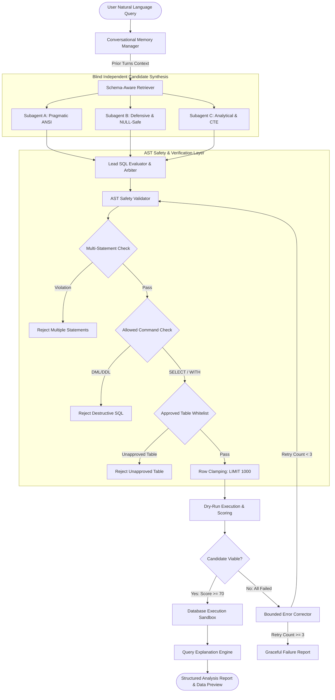

# DataPilot System Architecture

## 1. Architectural Philosophy

DataPilot is designed as an autonomous database analyst that converts natural language business inquiries into secure, high-performance SQL queries. 

In traditional enterprise setups, directly connecting an LLM to a database engine introduces significant security vulnerabilities (accidental data modification, multi-statement injection, unauthorized catalog access) and reliability issues (syntax hallucinations, cartesian joins, lack of business metric understanding).

DataPilot addresses these challenges by decoupling the query lifecycle into four distinct architectural layers:
1. **Context & Semantic Retrieval Layer**: Determines which tables, columns, and metric definitions are genuinely relevant.
2. **Blind Multi-Agent Synthesis Layer**: Evaluates multiple distinct SQL implementation strategies developed independently in isolation.
3. **AST Safety & Verification Firewall**: Enforces deterministic syntax, schema whitelisting, and execution limits before touching any database.
4. **Resilient Execution & Feedback Recovery Layer**: Runs queries against isolated databases with strict timeouts, capturing errors to trigger bounded self-correction loops.

---

## 2. System Architecture Diagram



---

## 3. Core Architectural Components

### 3.1 Conversational Memory Manager (`app/agent/memory.py`)
- **Responsibility**: Maintains conversation session history across user interactions.
- **State Tracked**: Previous natural language queries, generated SQL strings, active tables, returned row counts, and active filter criteria.
- **Follow-Up Detection**: Recognizes conversational follow-ups and refinements (e.g. *"Now filter those to the last 30 days"*, *"Order by sales descending"*, *"Top 3 only"*).
- **Context Synthesis**: Merges newly specified constraints directly into the existing SQL AST or prompt context without creating duplicate or contradictory queries.

### 3.2 Schema-Aware Retriever (`app/agent/schema_retriever.py`)
- **Responsibility**: Selects only the subset of tables, columns, foreign keys, and metrics required for the specific inquiry.
- **Catalog Management**: Maintains semantic descriptions, column data types, and concrete sample values for dimensional warehouse entities:
  - `dim_region`: Regional and geographic dimensions (`province`, `region_name`, `country`).
  - `dim_customer`: Customer attributes (`customer_name`, `gender`, `member_level`).
  - `dim_product`: Product catalog dimensions (`product_name`, `category`, `brand`).
  - `dim_date`: Temporal hierarchy (`year`, `quarter`, `month`, `day`).
  - `fact_order`: Transactional metrics (`order_quantity`, `order_amount`, and foreign keys).
- **Foreign Key Path Resolution**: Pre-computes approved join relationships (e.g., `fact_order.product_id = dim_product.product_id`) so the synthesis agents do not guess relational join keys.

### 3.3 Blind Independent Subagents (`app/agent/blind_sql_subagents.py`)
- **Responsibility**: Synthesizes candidate SQL queries from diverse engineering perspectives.
- **Blind Isolation**: Each candidate subagent works in complete isolation without seeing the thoughts, reasoning, or code produced by other subagents, preventing groupthink and common mode failures.
  - **Pragmatic SQL Subagent**: Focuses on direct, idiomatic ANSI SQL with straightforward joins and clean aggregations.
  - **Defensive SQL Subagent**: Focuses on boundary safety, wrapping sums in `COALESCE`, filtering `NULL` records, and implementing `CASE WHEN` division-by-zero guards.
  - **Analytical SQL Subagent**: Focuses on modular Common Table Expressions (`WITH ... AS (...)`), dimensional rollups, and ranking logic.

### 3.4 Lead SQL Evaluator & Arbiter (`app/agent/sql_evaluator.py`)
- **Responsibility**: Evaluates, grades, and arbitrates candidate queries to select the optimal solution.
- **Scoring Rubric (0 - 100 points)**:
  1. *Safety & Validation (40 points)*: AST validation status, strict read-only compliance, absence of multi-statements.
  2. *Schema Fidelity (30 points)*: Strict adherence to approved warehouse tables, valid column references, explicit join conditions.
  3. *Execution & Correctness (20 points)*: Clean dry-run execution on the development database, absence of runtime errors, non-empty row return.
  4. *Query Efficiency (10 points)*: Execution latency, presence of `LIMIT` clauses, avoidance of redundant scans.
- **Decision Engine**: Selects the top-scoring candidate with a score $\ge 70$. If all candidates fail, it packages error diagnostics and passes control to the bounded error correction workflow.

### 3.5 AST-Based SQL Safety Validator (`app/core/sql_safety.py`)
- **Responsibility**: Deterministic firewall executing before any query reaches the database engine.
- **Multi-Statement Defense**: Tokenizes input and detects semicolons outside quotes; rejects multiple chained statements.
- **Disallowed Command Blocking**: Explicitly forbids `DROP`, `DELETE`, `TRUNCATE`, `ALTER`, `INSERT`, `UPDATE`, `CREATE`, `REPLACE`, `GRANT`, `REVOKE`, `PRAGMA`, and administrative commands.
- **Table Whitelist Enforcement**: Restricts queries strictly to approved warehouse tables.
- **Automatic Row Clamping**: Enforces a `LIMIT 1000` ceiling on all queries to prevent memory exhaustion.

### 3.6 Bounded Error Corrector (`app/agent/bounded_correction.py`)
- **Responsibility**: Recovers from execution or validation errors through targeted correction loops.
- **Surgical Correction**: Identifies specific syntax patterns (e.g. missing join for a selected column, ambiguous column references, missing `GROUP BY` expressions) and applies rule-based corrections.
- **Bounded Retry Bounding**: Enforces a strict ceiling (`MAX_RETRIES = 3`). If the query fails after 3 iterations, execution halts gracefully with a structured failure diagnosis, eliminating infinite loops.

### 3.7 Synthetic Development Database (`app/db/synthetic_dev_db.py`)
- **Responsibility**: Self-contained SQLite/SQLAlchemy database seeded with realistic e-commerce data.
- **Zero-Dependency Execution**: Allows unit testing, integration verification, and CI/CD pipelines to run immediately without requiring Docker containers or external MySQL/Qdrant/ES clusters.
- **Timeout Protection**: Implements progress-handler timeouts (e.g., 5 seconds) to terminate long-running queries or accidental cartesian products.

### 3.8 Query Explanation Engine (`app/agent/explainer.py`)
- **Responsibility**: Formats execution results into professional business intelligence reports.
- **Fact vs. Insight Separation**:
  - *Verified Database Records*: Factual rows, column names, and row counts returned by the database.
  - *AI Analytical Insights*: Narrative interpretation and high-level trends.
- **Secret Sanitization**: Scans and redacts passwords, tokens, and database connection strings.

---

## 4. Execution State Management

State in DataPilot is managed through the `DataPilotResponse` and `DataAgentState` data models:

```python
class DataAgentState(TypedDict):
    query: str                          # Original user prompt
    keywords: list[str]                 # Extracted semantic keywords
    table_infos: list[TableInfoState]   # Retrieved table schema context
    metric_infos: list[MetricInfoState] # Business metric definitions
    date_info: DateInfoState            # Temporal context
    db_info: DBInfoState                # Database dialect and version
    candidates: list[CandidateSQL]      # Candidate queries from blind subagents
    evaluator_decision: EvaluatorDecision # Lead evaluator scoring and winner
    sql: str                            # Final selected or corrected SQL
    retry_count: int                    # Bounded error retry counter
    error: Optional[str]                # Error message if validation or execution fails
    execution_result: QueryExecutionResult # Result rows, columns, and latency
    explanation: StructuredExplanation  # Final structured analysis
```

---

## 5. Security & Isolation Matrix

| Threat Vector | Mitigation Strategy | Enforcement Component |
| :--- | :--- | :--- |
| **SQL Injection (DDL/DML)** | Tokenize and reject non-SELECT command tokens (`DROP`, `DELETE`, etc.) | `SQLSafetyValidator` |
| **Chained Statements** | Quote-aware statement splitting; reject `len(stmts) > 1` | `SQLSafetyValidator._split_into_statements` |
| **Catalog / System Probing** | Enforce approved table whitelist (`dim_*`, `fact_*`) | `SQLSafetyValidator._extract_table_names` |
| **Denial of Service (OOM)** | Automatic row clamping (`LIMIT 1000`) | `SQLSafetyValidator._enforce_row_limit` |
| **Hanging Cartesian Joins** | Execution timeout handler (aborts long queries) | `SyntheticDevelopmentDB.execute_query` |
| **Hallucinated Numbers** | Tabular source data explicitly separated from AI prose | `QueryExplainer.explain` |
| **Credential Leakage** | Regex sanitization of passwords and URIs | `QueryExplainer._redact_secrets` |
| **Infinite Error Loops** | Configurable retry bound (`max_retries = 3`) | `BoundedQueryCorrector.execute_bounded_correction` |

